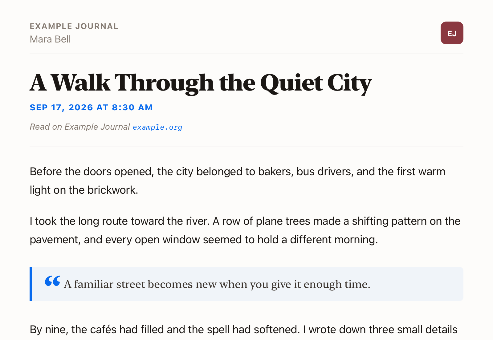

# Cinder, a NetNewsWire theme

A calm, light-mode only reading theme for [NetNewsWire](https://netnewswire.com).

Cinder is a restyle of the excellent [Ember](https://ember.marquard.org/) by Dave Marquard. Ember is warm and fiery; Cinder is what's left once the fire has cooled.

<p align="center">
  
</p>

## Why?

I really like dark-mode for my operating system chrome, but I prefer the content itself to be in light-mode. I couldn't find a way to configure this in NetNewsWire directly, but [it was recommended](https://discourse.netnewswire.com/t/force-light-mode-or-dark-mode/421) that I simply modify a theme I liked so it only had a light-mode, and so here we are!

## Install

Download the latest [`Cinder.nnwtheme.zip`](https://github.com/Rylon/cinder-nnwtheme/releases/latest):

- **macOS:** unzip and double-click `Cinder.nnwtheme`, then confirm the install.
- **iOS / iPadOS:** open the `.zip` and share it to NetNewsWire.

Then choose **Cinder** as your article theme in NetNewsWire's settings.

## What Cinder changes

- **Light only, in NetNewsWire's blue.** A warm off-white ground with NetNewsWire's default accent, `#086AEE`. Dark mode is deliberately switched off, so articles look the same whatever the system appearance.
- **Serif headings and quotations.** Headings and quoted text are set in Apple's New York serif against the SF Pro body, so a quotation reads as a different voice.
- **Quotation marks on quotes.** Each quotation opens with an oversized blue quote mark beside the text.
- **Citation links.** When a citation contains only a bare hyperlink, it is no longer uppercased, as uppercase hyperlinks look weird.
- **Quieter openings.** No drop cap and no accent bars over section headings.
- **Spaced code blocks.** Code blocks get the same space around them as a paragraph.
- **WordPress image comparison support.** WordPress (Jetpack)'s before/after slider doesn't work over RSS, so we show both images stacked and labelled **Before** and **After**.

## Kept from Ember

All the other excellent features of Ember are still present:

- **Apple system fonts** (SF Pro) throughout — nothing to download, crisp at every size.
- **Prominent pull-quotes** with a tinted panel and accent rule.
- **Full-bleed images** that span the column edge-to-edge, captions kept inset.
- **Captions set apart** in serif italic, with photo credits in muted small caps.
- **Broader footnote support** with native-style popovers for common Markdown, Substack, and WordPress footnote formats.
- **Platform-tuned** — Dynamic Type on iOS, a larger default size on iPad, and a desktop type scale on macOS.

## Requirements

A recent version of NetNewsWire (which supports custom `.nnwtheme` themes) on macOS, iOS, or iPadOS.

The additional footnote formats need NetNewsWire's **Article JavaScript** setting, which is on by default. With it off, Cinder still renders normally, but only the footnote formats NetNewsWire recognises itself get popovers.

## Structure

An `.nnwtheme` bundle is three files. NetNewsWire always loads its own `core.css`
first, then a theme's `stylesheet.css` (which fully replaces the default stylesheet).

```
Cinder.nnwtheme/
├── Info.plist       theme name, identifier, author, version
├── template.html    the article scaffold, plus the inline footnote adapter
└── stylesheet.css   the theme (self-contained; replaces the default)
```

## Developing & testing

Cinder uses [nnw-theme](https://github.com/dave-atx/nnw-theme), the tooling behind [netnewswire-theme-template](https://github.com/dave-atx/netnewswire-theme-template).

It renders each article through NetNewsWire's own pipeline (its pinned `core.css`, page skeletons, and scripts) and checks the result in WebKit, so layout work needs neither the app nor a NetNewsWire checkout.

**Requirements:** Node.js 24 or later (`brew install node` on macOS). Capturing new fixtures from the running app also needs Xcode and a NetNewsWire clone.

```sh
npx nnw-theme@2 setup      # once: install WebKit
npx nnw-theme@2 preview    # live gallery of every fixture; rebuilds on save
npx nnw-theme@2 check      # release gate: every fixture in WebKit, light and dark
```

Test cases are TOML fixtures in `fixtures/` whose keys mirror the `[[variables]]` in `template.html`; the tool's built-in `article` and `kitchen-sink` fixtures render alongside them. `npx nnw-theme@2 capture` explains how to save a real article from NetNewsWire as a new one. `footnote-providers.toml` declares the note each footnote format must open, which `check` verifies.

Contributor and agent guidance, including how to merge in upstream changes from Ember, lives in [`AGENTS.md`](AGENTS.md).

## Releasing

1. Run `npx nnw-theme@2 bump` and commit the new `Info.plist` version.
2. In GitHub, run **Actions → Publish theme** with the new tag (for example, `v1.1`).

The workflow checks the theme, refuses a reused tag or a version that did not increase, attaches `Cinder.nnwtheme.zip`, and writes the release notes from the commits since the last tag with [git-cliff](https://git-cliff.org). The download link points at `releases/latest`, so it always picks up the newest release.

## Licence

[Apache License 2.0](LICENSE). Ember © 2026 Dave Marquard; Cinder's changes © 2026 Ryan Conway.
